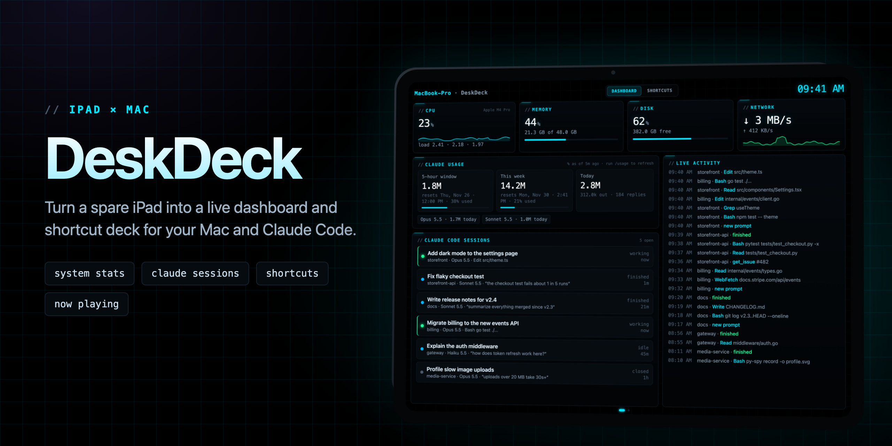
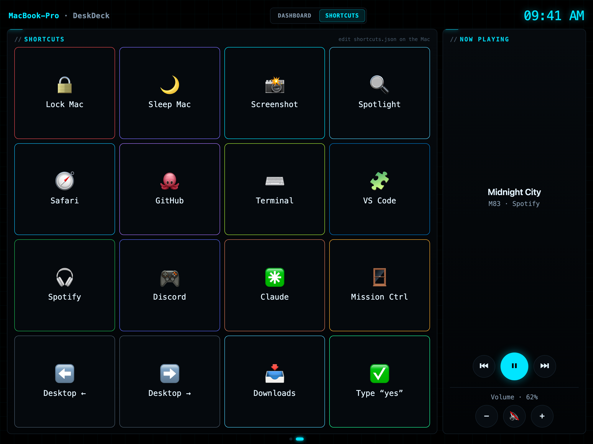
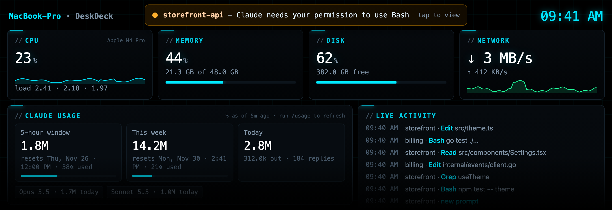

<p align="center">
  
</p>

<p align="center">
  <b>A live desk dashboard and shortcut deck for your Mac, on a spare iPad.</b><br>
  Nothing to install on the iPad. Only Python's standard library on the Mac.
</p>

<p align="center">
  
  
  
  
</p>

---

## Features

| | |
|---|---|
| 📊 **Mac stats** | CPU, memory, disk and network with live sparklines. Sampled only while the iPad is looking. |
| ✳️ **Claude Code** | Token usage for the 5-hour window, the week and today; every open session and what it's doing; a live feed of tool calls. |
| 🔔 **"Needs you" alerts** | A banner and a chime when a Claude Code session is waiting for your permission or answer. |
| 🎛️ **Shortcut deck** | Buttons that open apps, links, keystrokes, Apple Shortcuts, shell commands, or lock the Mac. Press an app button again to hide the app. |
| 🎧 **Now Playing** | Spotify, Music, and YouTube / SoundCloud / Spotify Web in Brave, Chrome, Edge, Arc or Safari. Play/pause, skip and volume. |
| 🔁 **Runs 24/7** | A background service that starts at login and restarts itself if it stops. |

<p align="center">
  
</p>

<p align="center">
  
  <br><sub>When a Claude Code session needs you, a banner appears on both pages and the iPad chimes.</sub>
</p>

## Quick start

```bash
git clone https://github.com/andrew-mapletech/DeskDeck.git deskdeck
cd deskdeck
python3 install.py
```

The installer:

- checks your Mac and Python (3.9 or newer, from [python.org](https://www.python.org/downloads/) if you don't have one)
- sets up the background service for this Mac and this folder
- offers to add the Claude Code hooks for live session status
- warns about shortcut buttons whose apps aren't installed
- prints the one-time permission steps and **the link to open on the iPad**

On the iPad, open that link in Safari and tap **Share → Add to Home Screen**. Set **Settings → Display & Brightness → Auto-Lock → Never**, then tap the dashboard once so it can keep the screen awake and play the alert chime.

> [!TIP]
> Moving to a new Mac or a new folder? Copy the folder, including the hidden `.token` file so the iPad link keeps working, and run `python3 install.py` again.

| Command | What it does |
|---|---|
| `python3 install.py` | Install, or repair after a move |
| `python3 install.py --check` | Report what's set up and change nothing |
| `python3 install.py --uninstall` | Remove the background service (asks about the hooks) |

## Shortcut buttons

Edit [`shortcuts.json`](shortcuts.json). The iPad picks up changes within 2 seconds, with no restart. Each button has an `id`, a `label`, an emoji `icon`, an optional border `color`, and a `type`:

| type | field | example |
|---|---|---|
| `app` | `app` | `"Visual Studio Code"`. Press again while it's in front to hide it. |
| `url` | `url` (+ optional `app`) | `"https://github.com"`. Add `"app": "Brave Browser"` to open it in Brave. |
| `keys` | `keys` | `"cmd+shift+4"`, `"ctrl+left"`, `"esc"`, `"f5"` |
| `text` | `text` | Types the text into the front app. |
| `shortcut` | `shortcut` | The name of an Apple Shortcuts shortcut. |
| `shell` | `command` | Any command, run on the Mac. |
| `lock` | | Locks the Mac like <kbd>⌃</kbd><kbd>⌘</kbd><kbd>Q</kbd>. The display stays on. |
| `empty` | | A placeholder slot. |

```json
{ "id": "vscode", "label": "VS Code", "icon": "🧩", "type": "app", "app": "Visual Studio Code", "color": "#007acc" }
```

`_examples` in the same file holds ready-made buttons (Screenshot, Spotlight, Mission Control, switch desktops…) to copy into `buttons`.

## One-time permissions

macOS asks the first time DeskDeck does each thing. The installer prints this list for your Mac.

| For | Turn on |
|---|---|
| Now Playing in **Brave / Chrome / Edge / Arc** | In the browser: **View → Developer → Allow JavaScript from Apple Events** |
| Now Playing in **Safari** | **Settings → Advanced → Show features for web developers**, then **Develop → Allow JavaScript from Apple Events** |
| Controlling Spotify, Music and browsers | Click **Allow** when asked. You can change it later in **System Settings → Privacy & Security → Automation → Python**. |
| `keys` and `text` buttons | **System Settings → Privacy & Security → Accessibility → Python** |
| The iPad reaching the Mac | Click **Allow** if macOS asks whether Python may accept incoming connections. |

Without the browser setting, Now Playing still shows a YouTube tab's title, but it can't tell whether it's playing and the buttons can't control it.

## Claude Code integration

`install.py` adds the hooks for you, or you can run `python3 install_hooks.py` directly (`--remove` to undo). The hooks go in `~/.claude/settings.json`, a backup is saved first, and each event is sent only to DeskDeck on `127.0.0.1`. If DeskDeck isn't running, a hook gives up after 1 second. Restart any open Claude Code sessions afterwards.

Token counts come from Claude Code's local logs in `~/.claude/projects`. The percentage of your plan used comes from Claude Code's own cache, so run `/usage` in Claude Code to refresh it.

## The background service

DeskDeck runs as `~/Library/LaunchAgents/com.deskdeck.server.plist`. It starts at login and restarts within about 10 seconds if it stops. The log, including the iPad link, is at `~/Library/Logs/DeskDeck.log`.

```bash
launchctl kickstart -k gui/$(id -u)/com.deskdeck.server   # restart after editing server.py
launchctl bootout gui/$(id -u)/com.deskdeck.server        # stop until next login
```

Changes to `index.html` or `shortcuts.json` don't need a restart. Just reload the iPad. `start-deskdeck.command` runs DeskDeck in a Terminal window instead, for debugging while the service is stopped.

## Project layout

```
deskdeck/
├── server.py           # HTTP server: stats, Claude Code, Now Playing, shortcuts
├── index.html          # the iPad web app (single file, no build step)
├── shortcuts.json      # your buttons
├── install.py          # all-in-one installer
├── install_hooks.py    # adds or removes the Claude Code hooks
├── start-deskdeck.command
└── docs/               # README images
```

## Good to know

- Anyone on your Wi-Fi with the full link (`?k=…`) can press your buttons. To change the key, delete `.token` and restart. For access away from home, use Tailscale rather than opening port 8770.
- Run on a different port with `DESKDECK_PORT=8771 python3 install.py`.
- The `lock` button uses a macOS function Apple doesn't document. If a future macOS removes it, the button falls back to turning the display off, which still locks if your Mac requires a password straight away.
